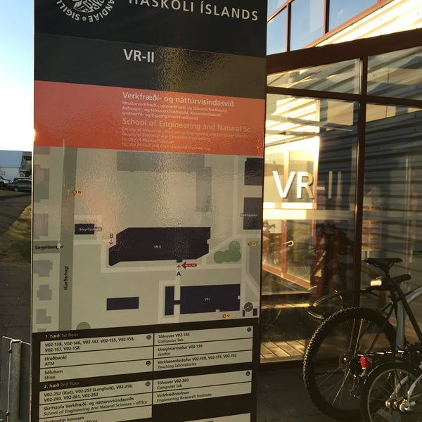

```{r setup}
#| include: false
# Run from kynning/, so the book's helpers find ../data exactly as from docs/.
library(tidyverse)
source("../R/gogn.R")

les <- function(db, sql) {
  con <- DBI::dbConnect(RSQLite::SQLite(), db, flags = RSQLite::SQLITE_RO)
  on.exit(DBI::dbDisconnect(con))
  as_tibble(DBI::dbGetQuery(con, sql))
}
ldb <- file.path("..", "data", "licences.sqlite")
hdb <- file.path("..", "data", "hagstofa.sqlite")

skrar <- c(verkfraedingur = "Verkfræðingar", taeknifraedingur = "Tæknifræðingar")
litir <- c("Verkfræðingar" = "#10099F", "Tæknifræðingar" = "#D61F69")
tala <- function(x, d = 0) format(round(x, d), big.mark = ".", decimal.mark = ",", nsmall = d)
thema <- theme_minimal(base_size = 15) +
  theme(legend.position = "bottom", panel.grid.minor = element_blank(),
        plot.caption = element_text(colour = "grey40", size = 10))

# Licence holders with the name-based gender estimate; 2026 is not a full year.
lg <- les(ldb, "select list, licence_year as year, birth_year, gender from licence_gender") |>
  mutate(skra = factor(skrar[list], levels = skrar), aldur = year - birth_year)
til <- max(hag$hlutfall$year)
lg_heil <- filter(lg, year <= til)
mf <- les(hdb, "select year, n as pop from population_current
                where sex = 'total' and age is null and year >= 1962")
# Master's degrees in verkfræði programmes per year, by our classification.
ms_vf <- les(hdb, "
  select g.year, sum(g.n) as n from graduation_current g
  join programme_group p using (programme_code)
  where p.programme_group = 'verkfraedi' and g.sex = 'total' and g.degree_code = '4'
  group by 1")
ms_vf_nu <- mean(ms_vf$n[ms_vf$year > til - 5])
```



::: {.notes}
- Þakka fyrir að fá að koma; ég er lektor í iðnaðarverkfræði við HÍ
- Undanfarinn mánuð hef ég safnað gögnum um verkfræðimenntun, meistararitgerðir og starfsheitaleyfi
- Markmið fundarins: sýna hvað ég hef, bera saman glósur og ræða samstarf
:::

---

## Um hvað viljum við ræða?

::: {.fa-card cols=3}
- user-plus | **Nýliðun** | Hvernig nýliðun í stéttinni hefur þróast í gegnum árin
- users | **Fjöldi og samsetning** | Breytingar á fjölda, kynjahlutfalli og aldri
- sitemap | **Undirgreinar** | Þróun undirgreina og hvernig flokkun þeirra hefur breyst
- link | **Menntun, leyfi og aðild** | Tengslin milli náms, starfsheitaleyfa og félagsaðildar
- [hi-teal] database | **Gögn VFÍ** | Hvaða gögn VFÍ hefur sem gætu varpað ljósi á þróunina
- [hi-teal] handshake | **Samstarf** | Greinar, gagnagreining eða sögulegt yfirlit
:::

::: {.notes}
- Þetta eru punktarnir úr fundarboðinu
- Fyrstu fjórir: hvað gögnin sýna nú þegar
- Síðustu tveir (grænblátt): það sem ég myndi vilja ræða við ykkur
:::

---

## Gögnin sem ég hef safnað

::: {.fa-card cols=2}
- id-card | **Leyfisskrár Stjórnarráðsins** | /`r tala(nrow(lg))` leyfishafar | Verkfræðingar frá 1962, tæknifræðingar frá 1965. Fæðingarár og leyfisár; kennitölur ekki vistaðar.
- chart-column | **Hagstofa Íslands** | /Mannfjöldi, nemendur, brautskráningar | Brautskráningar eftir námsbraut 1996–`r til`, nemendur heima og erlendis 1977–2006, afdrif árganga.
- book | **Skemman** | /Innlendar meistararitgerðir | Lokaverkefni í verkfræði, safnað með `skemman-harvester`; tenging höfunda við leyfisskrá er í vinnslu.
- venus-mars | **Mannanafnaskrá** | /Áætlað kyn út frá nafni | -dóttir, eiginnafn, -son; aðeins birt samandregið.
:::

::: {.lean-in}
Allt er opið: [hi-idn.github.io/engineers-is](https://hi-idn.github.io/engineers-is/) · kóði, heimildir og aðferðir í vinnudagbók.
:::

::: {.notes}
- Allt sótt sjálfvirkt og varðveitt með söfnunartíma, svo breytingar á skránum eru rekjanlegar
- Kynjamat er mat út frá nafnavenju, ekki kyn einstaklinga
:::

---

## Fjögur ólík fyrirbæri

| Þrep | Það sem ég hef | Það sem vantar, og hvar það gæti verið |
|---|---|---|
| **Nám** | Nemendur og árgangar (Hagstofa) | Umsóknir um nám: HÍ, og mögulega HR |
| **Brautskráning** | Brautskráningar (Hagstofa); hverjir skiluðu í Skemmuna og gráða (ECTS) | Margar ritgerðir lokaðar; fjöldi frá sviðum HÍ og HR |
| **Starfsheitaleyfi** | Leyfisskrár Stjórnarráðsins, 1962– | Skráin er ófullkomin: a.m.k. einn leyfishafi finnst ekki á vefnum. Samkeyrsla við gögn VFÍ |
| **Starfandi stétt** | Ekkert | Virk félagsaðild og vinnustaðir: VFÍ |

: {tbl-colwidths="[18,37,45]"}

::: {.callout}
Leyfisskráin mælir fyrst og fremst **þriðja þrepið**. Uppsafnaður fjöldi leyfa er hvorki fjöldi starfandi verkfræðinga né fjöldi þeirra sem búa á Íslandi.
:::

::: {.notes}
- Þetta er rammi allrar greiningarinnar; hvert þrep þarf sína heimild
- Nám: get mögulega fengið fjölda umsókna frá HÍ og óskað eftir sambærilegum tölum frá HR
- Brautskráning: Skemman sýnir hverjir skiluðu ritgerð og stærð hennar í ECTS, en margar eru lokaðar; sviðin gætu deilt fjölda
- Leyfi: fann dæmi um leyfishafa sem er ekki á vef Stjórnarráðsins, svo samkeyrsla við gögn VFÍ væri gagnleg
- Starfandi stétt: hér hefur VFÍ líklega bestu gögnin
:::

---

## {.section-break}

<span class="kicker">1 · Nýliðun</span>

<h1>Nýliðun í stéttinni</h1>

<p class="claim">Ný starfsheitaleyfi á ári, miðað við mannfjölda.</p>

---

## Nýliðun hefur tvöfaldast miðað við mannfjölda

```{r nylidun}
#| fig-alt: "Ný starfsheitaleyfi á ári á hverja 100.000 íbúa, 1962–2025."
nyl <- lg_heil |>
  count(skra, year) |>
  group_by(skra) |>
  complete(year = full_seq(c(min(year), til), 1), fill = list(n = 0)) |>
  ungroup() |>
  inner_join(mf, by = "year") |>
  mutate(rate = 1e5 * n / pop) |>
  group_by(skra) |>
  mutate(ma3 = as.numeric(stats::filter(rate, rep(1 / 3, 3)))) |>
  ungroup()
timabil <- function(fra, tl) nyl |> filter(year >= fra, year <= tl) |>
  group_by(skra) |> summarise(r = 1e5 * sum(n) / sum(pop))
t7009 <- timabil(1970, 2009)
t2020 <- timabil(2020, til)

ggplot(nyl, aes(year, colour = skra)) +
  geom_line(aes(y = rate), linewidth = 0.3, alpha = 0.5) +
  geom_line(aes(y = ma3), linewidth = 1.2, na.rm = TRUE) +
  scale_colour_manual(values = litir) +
  scale_x_continuous(breaks = seq(1960, 2030, 10)) +
  labs(x = NULL, y = "Ný leyfi á 100.000 íbúa", colour = NULL,
       caption = "Þykka línan er þriggja ára hreyfanlegt meðaltal. Heimild: leyfisskrár Stjórnarráðsins; Hagstofa Íslands (MAN08000).") +
  thema
```

Verkfræðingar: um **`r tala(t7009$r[1])`** ný leyfi á 100.000 íbúa á ári 1970–2009, en um **`r tala(t2020$r[1])`** frá 2020. Tæknifræðingar: `r tala(t7009$r[2])` og `r tala(t2020$r[2])`.

::: {.notes}
- Aukningin hefst um 2010 og hefur haldist
- Hún fellur í tíma við BS/MS-kerfið (1997), Verkfræðideild HR (2005) og reglur nr. 1105/2015, en nálægð í tíma sannar ekki orsök
- Tæknifræðingar hafa verið stöðugir eða fækkað miðað við mannfjölda
- Lág gildi um 1992–1994 gætu verið skráningareyða; þarf að kanna
:::

---

## {.section-break}

<span class="kicker">2 · Fjöldi og samsetning</span>

<h1>Fjöldi og samsetning</h1>

<p class="claim">Hverjir fá leyfi, hve gamlir og af hvaða kyni.</p>

---

## Konum hefur fjölgað mikið meðal nýrra verkfræðinga

```{r konur}
#| fig-alt: "Áætlað hlutfall kvenna af nýjum leyfishöfum eftir fimm ára tímabilum."
kon <- lg_heil |>
  mutate(bil = 5 * ((year - 1) %/% 5) + 1) |>  # 1961–1965, …, 2021–2025
  group_by(skra, bil) |>
  summarise(n = n(), konur = 100 * mean(gender %in% "female"), .groups = "drop") |>
  filter(n >= 20)
kon_vf <- kon |> filter(skra == "Verkfræðingar")

ggplot(kon, aes(bil + 2, konur, colour = skra)) +
  geom_line(linewidth = 1.2) + geom_point(size = 2.5) +
  scale_colour_manual(values = litir) +
  scale_x_continuous(breaks = seq(1960, 2030, 10)) +
  scale_y_continuous(labels = \(x) paste0(x, "%"), limits = c(0, NA)) +
  labs(x = NULL, y = "Áætlaðar konur af nýjum leyfum", colour = NULL,
       caption = "Fimm ára tímabil. Kyn áætlað út frá nafni; nöfn sem engin regla sker úr (4%) teljast í nefnara.") +
  thema
```

Meðal nýrra verkfræðinga er hlutur kvenna kominn úr nokkrum prósentum á 8. áratugnum í um **`r tala(last(kon_vf$konur))`%** á síðasta tímabili; meðal tæknifræðinga er hann mun lægri.

::: {.notes}
- Fyrsti leyfishafi á verkfræðingaskránni sem metinn er kona fékk leyfi 1969, en Kristín Hallberg Jónsdóttir lauk verkfræðiprófi 1942 — skráin nær ekki aftur fyrir 1962
- Bráðabirgðatölur: kynjamatið er mat út frá nafnavenju
:::

---

## Uppsafnaður fjöldi og aldur við leyfi

```{r fjoldi-aldur}
#| include: false
upps <- lg_heil |> count(skra, year) |> group_by(skra) |>
  mutate(samtals = cumsum(n)) |> ungroup()
aldur <- lg_heil |>
  filter(aldur >= 18, aldur <= 90) |>
  mutate(aratugur = 10 * (year %/% 10)) |>
  group_by(skra, aratugur) |>
  summarise(midgildi = median(aldur), .groups = "drop")
ald_vf <- aldur |> filter(skra == "Verkfræðingar")
```

::: {.two-col}
::: {}
```{r upps}
#| fig-width: 6
#| fig-height: 4.6
#| fig-alt: "Uppsafnaður fjöldi starfsheitaleyfa frá 1962."
ggplot(upps, aes(year, samtals, colour = skra)) +
  geom_line(linewidth = 1.2) +
  scale_colour_manual(values = litir) +
  scale_y_continuous(labels = \(x) format(x, big.mark = ".")) +
  labs(x = NULL, y = "Uppsöfnuð leyfi", colour = NULL) +
  thema
```
:::

::: {}
::: {.block .alert}
**Ekki stærð stéttarinnar.** Uppsöfnuð leyfi telja líka þá sem eru hættir, fluttir úr landi eða látnir. Leyfisskráin segir ekkert um starf, búsetu eða undirgrein.
:::

Miðgildi aldurs nýrra verkfræðinga við leyfi var **`r tala(ald_vf$midgildi[ald_vf$aratugur == 1970])`** ár á 8. áratugnum en **`r tala(ald_vf$midgildi[ald_vf$aratugur == 1990])`–`r tala(max(ald_vf$midgildi))`** ár frá 1990.
:::
:::

::: {.notes}
- Rúmlega helmingur allra verkfræðingaleyfa hefur verið veittur eftir 2010
- Aldurinn hækkar á 10. áratugnum og helst svo; MS-próf varð skilyrði 1997
- Til að meta starfandi stétt þyrfti gögn um búsetu, starf eða félagsaðild
:::

---

## {.section-break}

<span class="kicker">3 · Menntun</span>

<h1>Menntun</h1>

<p class="claim">Frá námi erlendis til fimm ára náms heima.</p>

---

## Tímamót í verkfræðimenntun

::: {.steps}
- 1940–1944 | Kennsla hefst við HÍ; Verkfræðideild stofnuð
- 1970–1974 | Fjögurra ára lokaprófsnám; fyrstu brautskráðir
- 1997 | BS + MS; MS-próf verður skilyrði starfsheitis
- 2005 | Verkfræðideild HR stofnuð
- 2015 | Reglur nr. 1105/2015 um leyfishæft nám
:::

::: {.lean-in}
Lög um starfsheitið frá 1937; núgildandi lög nr. 8/1996. Fagfélögin setja reglur um hvaða nám veitir rétt til starfsheitisins.
:::

::: {.notes}
- Þar til 1970 þurfti að ljúka námi erlendis; 1946–1948 útskrifuðust sjö úr byggingarverkfræði
- Tækniskóli Íslands 1964 → Tækniháskóli 2002 → sameinaður HR 2005
- Eldri saga VFÍ og eldri leyfi (fyrir 1962) vantar í gögnin
:::

---

## Lengi lærðu fleiri erlendis en heima

::: {.two-col}
::: {}
```{r erlendis}
#| fig-width: 7.2
#| fig-height: 4.8
#| fig-alt: "Nemendur í tæknigreinum og verkfræði á Íslandi og erlendis 1977–2006."
nem <- hag$nemar |>
  mutate(stadur = factor(c(iceland = "Á Íslandi", abroad = "Erlendis")[place],
                         levels = c("Á Íslandi", "Erlendis")))
ggplot(nem, aes(year, n, colour = stadur)) +
  geom_line(linewidth = 1.2) + geom_point(size = 2) +
  scale_colour_manual(values = c("Á Íslandi" = "#10099F", "Erlendis" = "#D61F69")) +
  scale_y_continuous(limits = c(0, NA)) +
  labs(x = NULL, y = "Skráðir nemendur", colour = NULL,
       caption = "Öll námsstig. Heimild: Hagstofa Íslands (SKO04103).") +
  thema
```
:::

::: {}
**Hugleiðingar: af hverju heim um 1990?**

- **1989–1991:** meistaranám í verkfræði hefst við HÍ
- **1992:** ný LÍN-lög gera nám erlendis dýrara; samdráttur í efnahagslífinu
- **1992:** stökk um 237 nemendur heima á einu ári; breytt talning?

::: {.lean-in}
Óstaðfest; VFÍ gæti vitað betur.
:::
:::
:::

::: {.notes}
- Samfellt 1982–1991 voru fleiri erlendis en heima; leyfi þess tíma endurspegla nám sem íslensk brautskráningargögn ná ekki til
- Erlendis fækkar jafnt frá 1988 (589) til 1994 (290); heima flatt um 360 og svo stökk úr 427 (1991) í 664 (1992)
- Flokkurinn „Tæknigreinar, verkfræði“ nær líka yfir tæknifræði; Tækniskólinn gæti hafa farið að teljast til háskólastigs
- Þetta skiptir máli fyrir túlkun: brautskráningargögn ná aðeins aftur til 1996
- VFÍ hefur metið erlent nám: gögn um það væru verðmæt
:::

---

## Hlutur verkfræði og tæknifræði í brautskráningum

::: {.two-col}
::: {}
| Prófgráða | 1996–2000 | 2021–2025 |
|---|--:|--:|
| Grunnnám | 5,8% | **10,8%** |
| Meistaranám | 10,2% | **3,9%** |
| Doktorsnám | 0,0% | 13,1% |
| Allar gráður | 4,4% | 7,1% |

: Hlutfall af öllum brautskráningum sömu gráðu. Heimild: Hagstofa Íslands.
:::

::: {}
::: {.fa-card cols=1}
- graduation-cap | **Grunnnámið hefur stækkað** | Hlutur verkfræði og tæknifræði í BS-prófum hefur nær tvöfaldast.
- scale-unbalanced | **Minni hlutur í meistaranámi** | Meistaragráðum í öllum greinum fjölgaði úr `r tala(heild(1996, "4"))` í `r tala(heild(til, "4"))` á ári, í verkfræði úr `r ms_vf$n[ms_vf$year == 1996]` í `r ms_vf$n[ms_vf$year == til]`. Síðustu fimm ár eru um **`r tala(ms_vf_nu)`** á ári í verkfræði. Verkfræðin óx líka, en aðrar greinar mun hraðar.
- person-walking-arrow-right | **Lítið brottfall** | Af nýnemum í verkfræði o.fl. 2017 luku 70% bakkalárprófi á sama sviði innan sex ára, á móti 62% í öllu bakkalárnámi og 46% í raunvísindum.
:::
:::
:::

::: {.notes}
- Tölurnar eru úr kafla 6 í vinnudagbókinni
- Hagstofan telur prófgráður, ekki einstaklinga
- Brottfallstölur eftir sviði eru aðeins til fyrir árgangana 2014 og 2017
- Hagstofan rekur aðeins þriggja ára bakkalárnám (BS, BA, B.Ed. o.fl.); BS er ekki aðgreint frá BA og annað grunnnám, t.d. diplómanám, er ekki með
:::

---

## Brautskráningar og ný leyfi

```{r ms-leyfi}
#| fig-alt: "Meistaragráður í verkfræði og ný verkfræðingaleyfi á ári frá 1996."
ms <- ms_vf |> mutate(rod = "Meistaragráður í verkfræði (Hagstofa)")
vl <- lg_heil |> filter(list == "verkfraedingur", year >= 1996) |> count(year) |>
  mutate(rod = "Ný verkfræðingaleyfi")
ggplot(bind_rows(ms, vl), aes(year, n, colour = rod)) +
  geom_line(linewidth = 1.2) + geom_point(size = 2) +
  scale_colour_manual(values = c("#2DD2C0", "#10099F")) +
  scale_y_continuous(limits = c(0, NA)) +
  labs(x = NULL, y = "Á ári", colour = NULL,
       caption = "Bráðabirgðasamanburður án tafar; leyfi ná líka til þeirra sem lærðu erlendis. Heimild: Hagstofa Íslands (SKO04205c); leyfisskrár Stjórnarráðsins.") +
  thema
```

Fleiri fá verkfræðingaleyfi en ljúka meistaragráðu í verkfræði hér á landi. Munurinn er að hluta nám erlendis og að hluta námsbrautir sem Hagstofan flokkar utan verkfræði.

::: {.notes}
- Fyrir 1997 dugði fjögurra ára lokapróf, svo samanburður við meistaragráður á aðeins við eftir það
- Þetta er ekki greint með töf; næsta glæra sýnir tíma frá ritgerð til leyfis
- Orkufræði (335 meistaragráður) og umhverfisfræði eru utan flokkunarinnar en gætu geymt verkfræðinga
- Hér gætu gögn VFÍ um mat á umsóknum skýrt muninn
:::

---

## Frá meistararitgerð til leyfis

<span class="slide-subtitle">Höfundar meistararitgerða í Skemmu paraðir við leyfisskrárnar eftir nafni og fæðingarári</span>

::: {.fa-card cols=3}
- clock | **Um hálft ár** | Miðgildi tíma frá ritgerð til leyfis í öllum stóru greinunum; flest leyfi koma innan árs.
- percent | **50–70% fá leyfi** | Hlutfall verkfræðiritgerða sem leiða til leyfis, stöðugt fram til 2023; nýrri árgangar hafa ekki haft tíma.
- [hi-teal] code-branch | **Munur eftir greinum** | Byggingarverkfræði hæst í HÍ og HR; orkuverkfræði lægri; tölvunarfræði nær aldrei.
:::

::: {.two-col}
::: {.block}
**667 ritgerðir** leiða til leyfis: 610 til verkfræðingsleyfis eingöngu, 56 til beggja og ein aðeins til tæknifræðingsleyfis. Í 101 tilviki átti höfundur leyfi fyrir.
:::

::: {.block .alert}
**Neðri mörk.** Umsókn kostar og ekki allir sækja um. Leyfið er afgreitt með umsögn VFÍ, samhliða umsókn um aðild, svo VFÍ gæti vitað meira um hverjir sækja um.
:::
:::

::: {.notes}
- Úr greiningunni í skemman-msc (kafli 8, grein msc-analysis); bráðabirgðatölur
- Samsvörun í þremur þrepum: fullt nafn + fæðingarár, samhæft millinafn, fyrsta og síðasta nafn
- Leyfi telst fylgja ritgerð ef það kemur eftir skiladag og innan 2,5 ára
- Nafnasamsvörun getur ruglað saman tveimur einstaklingum; þar gæti samkeyrsla við VFÍ hjálpað
- Lítið hlutfall í orkuverkfræði: þverfaglegt nám sem er ekki allt leyfishæft samkvæmt reglum 1105/2015
:::

---

## {.section-break}

<span class="kicker">4 · Undirgreinar</span>

<h1>Undirgreinar</h1>

<p class="claim">Hvaða verkfræði er kennd, og hvernig er hún flokkuð?</p>

---

## Brautskráningar eftir námsbraut

```{r undirgreinar}
#| fig-alt: "Brautskráningar í verkfræði eftir námsbraut og fimm ára tímabilum, BS og MS saman."
ub <- les(hdb, "
  select g.year, p.programme as braut, sum(g.n) as n from graduation_current g
  join programme_group p using (programme_code)
  where p.programme_group = 'verkfraedi' and g.sex = 'total' and g.degree_code in ('2', '4')
  group by 1, 2") |>
  mutate(braut = fct_lump_n(braut, 7, w = n, other_level = "Aðrar brautir"),
         bil = paste0(5 * ((year - 1) %/% 5) + 1, "–", 5 * ((year - 1) %/% 5) + 5)) |>
  count(bil, braut, wt = n) |>
  mutate(braut = fct_reorder(braut, n, .fun = sum, .desc = TRUE) |>
           fct_relevel("Aðrar brautir", after = Inf))
ggplot(ub, aes(bil, n, fill = braut)) +
  geom_col(width = 0.75) +
  scale_fill_manual(values = c("#10099F", "#2DD2C0", "#D61F69", "#FAC55B", "#FFA05F",
                               "#8C8FD9", "#FC8484", "grey70")) +
  labs(x = NULL, y = "BS- og MS-gráður", fill = NULL,
       caption = "Námsbrautir Hagstofunnar sem bera heiti verkfræði, BS og MS saman. Heimild: Hagstofa Íslands (SKO04205c).") +
  thema + theme(legend.position = "right")
```

::: {.notes}
- Véla- og iðnaðarverkfræði er stærst; hugbúnaðar-, heilbrigðis- og hátækniverkfræði eru nýjar
- Heiti fylgja Hagstofunni og breytast: t.d. rafmagns- og tölvuverkfræði, rekstrar-/fjármálaverkfræði saman
:::

---

## Flokkunin er sjálf viðfangsefni

::: {.fa-card cols=2}
- shuffle | **Heiti breytast** | Brautir sameinast, skiptast og fá ný heiti; HÍ og HR nefna sömu greinar ólíkt (t.d. rafmagnsverkfræði í BSc, raforkuverkfræði í MSc).
- layer-group | **Svið Hagstofunnar falla ekki að skólunum** | Lífverkfræði og reikniverkfræði eru í raunvísindum, iðnaðartæknifræði í félagsvísindum.
- circle-question | **Gráu svæðin** | Orkufræði, umhverfisfræði og tölvunarfræði: hvenær er námið leyfishæft?
- id-card | **Leyfisskráin þegir** | Starfsheitið er „verkfræðingur“; skráin segir ekkert um undirgrein.
:::

::: {.callout}
Hvernig hefur VFÍ flokkað undirgreinar, í félagatali, deildum eða mati á námi, og hvernig hefur sú flokkun breyst?
:::

::: {.notes}
- Hér held ég að VFÍ hafi sterkari gögn en nokkur annar
- Söguleg flokkun VFÍ gæti orðið burðarás í greiningu á undirgreinum
:::

---

## {.section-break}

<span class="kicker">5 · Menntun, leyfi og félagsaðild</span>

<h1>Hvað vantar?</h1>

<p class="claim">Keðjan frá námi til starfs, og hlekkirnir sem vantar.</p>

---

## Frá námi til félagsaðildar

::: {.steps}
- Nám | Hagstofa · nemendur og árgangar
- Brautskráning | Hagstofa · Skemman
- Leyfi | Leyfisskrá Stjórnarráðsins
- Félagsaðild | **VFÍ?**
- Starf og undirgrein | **VFÍ? Kjarakannanir?**
:::

::: {.two-col}
::: {.block}
**Það sem er hægt nú:** nýliðun, aldur og áætlað kyn leyfishafa; brautskráningar eftir braut; tími frá meistararitgerð að leyfi (í vinnslu).
:::

::: {.block .alert}
**Það sem vantar:** hverjir starfa sem verkfræðingar, í hvaða undirgrein, og hve stór hluti leyfishafa er í félaginu.
:::
:::

::: {.notes}
- Síðustu tveir hlekkirnir eru þar sem VFÍ kemur inn
- Allt má vinna samandregið, án persónugreinanlegra upplýsinga í birtingu
:::

---

## Gögn sem ég myndi vilja skoða með VFÍ

::: {.fa-card cols=3}
- address-book | **Félagatal yfir tíma** | Fjöldi félaga eftir ári inngöngu, undirgrein, kyni, aldri og námslandi. Samandregið nægir.
- user-check | **Virk aðild** | Hverjir eru enn virkir félagsmenn og vinna við verkfræðistörf?
- building | **Hvert fara verkfræðingar?** | Verkfræðistofur, stórfyrirtæki, sprotar, hið opinbera eða annað.
- arrows-rotate | **Samkeyrsla við leyfisskrá** | Leyfishafar sem vantar á vef Stjórnarráðsins, og eldri leyfi en 1962.
- scale-balanced | **Umsagnir um leyfishæft nám** | Hvaða nám hefur verið metið, frá hvaða löndum og skólum, og hvenær reglurnar breyttust.
- landmark | **Söguleg gögn og kjarakannanir** | Eldri félagatöl og verkfræðingatöl, Tímarit VFÍ, starfssvið í kjarakönnunum.
:::

::: {.lean-in}
Engar kennitölur þurfa að fara á milli: samandregnar töflur, eða tenging á öruggum stað með vinnslusamningi.
:::

::: {.notes}
- Spyrja: hvaða gögn eru til, á hvaða formi og frá hvaða tíma?
- Hvernig hefur flokkun félagsmanna í undirgreinar/deildir breyst?
- Persónuvernd: ég vinn aðeins með samandregnar tölur í birtingu
:::

---

## Hugsanlegt samstarf

::: {.fa-card cols=3}
- file-lines | **Greinar** | Ritrýnd grein um nýliðun 1962–2026 (í vinnslu), og styttri greinar í Verktækni eða á vef VFÍ.
- chart-line | **Gagnagreining** | Sameiginleg greining á félagatali og leyfum; endurtakanleg, svo hana má uppfæra árlega.
- clock-rotate-left | **Sögulegt yfirlit** | Saga verkfræðimenntunar, starfsheitis og undirgreina, með opnum gögnum og heimildum.
:::

::: {.statement}
Næsta skref: sammælast um hvaða gögn eru til og hvaða spurningum VFÍ vill helst fá svar við.
:::

::: {.notes}
- Hvað myndi nýtast VFÍ sjálfu, t.d. í umræðu um menntun og nýliðun?
- Vinnudagbókin er opin og má vísa í hana
:::

---

## Takk fyrir! {.focus-slide}

::: {.two-col}
::: {.col}
{.contact-photo}
:::

::: {.col}


Vinnudagbók: [hi-idn.github.io/engineers-is](https://hi-idn.github.io/engineers-is/)
:::
:::
